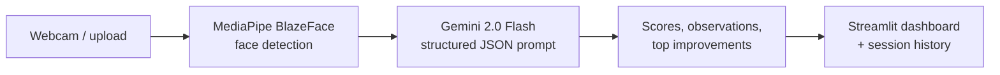

# AI Grooming Mirror

A Streamlit app that gives instant, structured feedback on personal grooming — useful before an interview, a meeting or a video call. Take a webcam photo or upload one; the app detects the face with MediaPipe and then uses Google Gemini's vision model to score six grooming categories and suggest the three most impactful improvements.

---

## Features

- **Webcam or photo upload** — capture directly in the browser or upload a JPG / PNG
- **Face detection** — MediaPipe BlazeFace locates the face and draws an annotated preview before analysis
- **Multimodal analysis** — Gemini 2.0 Flash reviews the full image and returns structured JSON
- **Scored report** — an overall score (0–100) with a verdict, plus individual scores, observations and feedback for:
  - Hair
  - Face & skin
  - Facial hair
  - Clothing condition
  - Hands & nails
  - Overall hygiene impression
- **Top 3 improvements** — the most impactful, specific changes to make
- **Session history** — compare earlier analyses in the History tab

## How it works



The prompt asks Gemini to return only JSON in a fixed schema, which the app parses into score cards and progress bars.

## Tech stack

Python · Streamlit · Google Gemini (google-genai SDK) · MediaPipe · OpenCV · Pillow · NumPy

## Run locally

```bash
python -m venv venv
source venv/bin/activate        # Windows: venv\Scripts\activate
pip install -r app/requirements.txt

cp .env.example .env            # then add your key
streamlit run app/app.py
```

Get a free Gemini API key from [Google AI Studio](https://aistudio.google.com). You can put it in `.env` as `GEMINI_API_KEY` or paste it into the app's sidebar.

On first run the app downloads the MediaPipe face-detection model (a few MB) to your temp folder.

## Project structure

```
├── app/
│   ├── app.py            Streamlit UI, MediaPipe detection, Gemini analysis
│   └── requirements.txt
└── .env.example          template for GEMINI_API_KEY
```

## Privacy

Photos are processed in memory for the current session and sent only to the Gemini API for analysis; nothing is stored on disk by the app.
